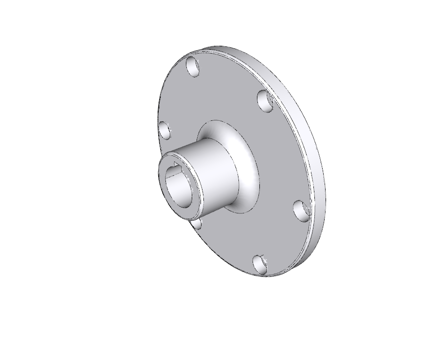
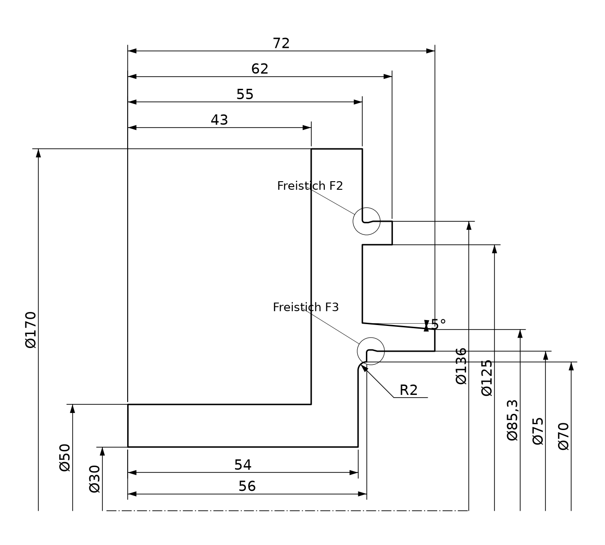
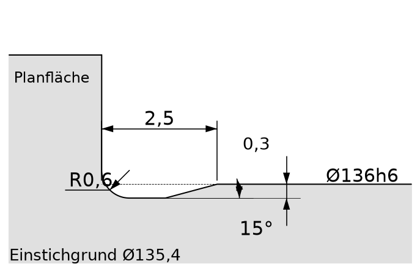
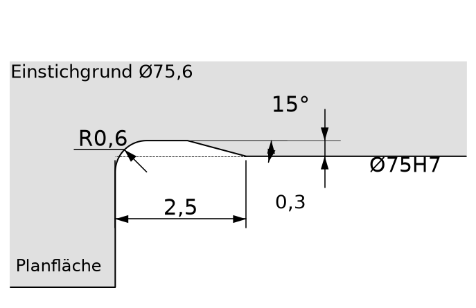
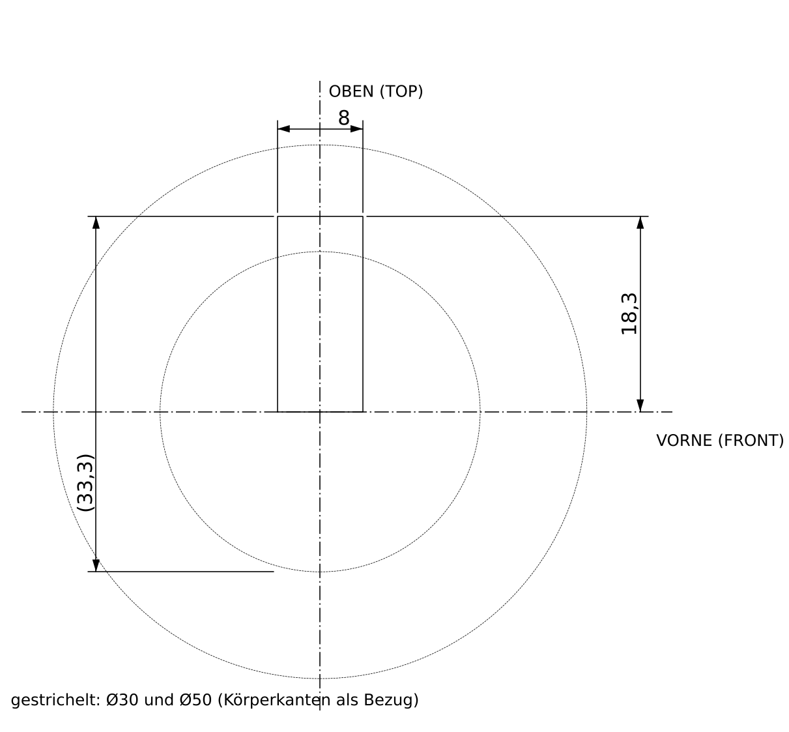
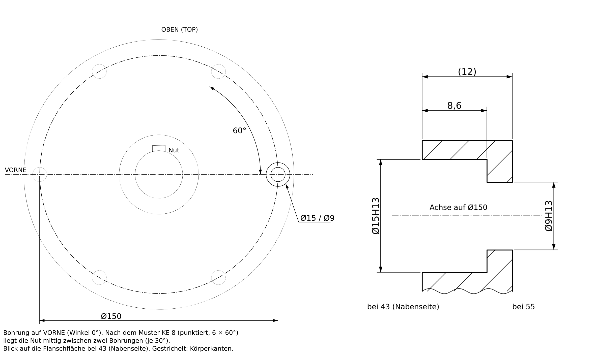
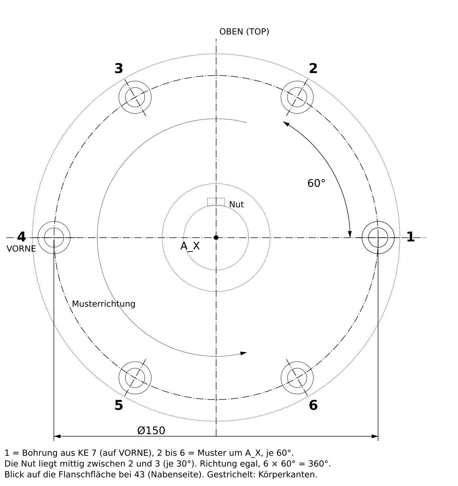

# Abtriebsnabe (Pos. 2) – Schritt für Schritt in Creo 12

Von der leeren Datei bis zum fertigen Teil · POS02_ABTRIEBSNABE · EN-GJS-700-2 · Endvolumen 350.370 mm³

Nach jedem KE steht das Volumen, das du dann haben musst (Analyse → Masseneigenschaften).

## Übersicht: Modellbaum

| KE | Funktion in Creo | Ergebnis | Volumen danach |
|---|---|---|---|
| 1 | Drehen | Grundkörper mit Freistichen | 356.379 mm³ |
| 2 | Rundung | R10 Nabe / Flansch | 360.051 mm³ |
| 3 | Rundung | 2 × R5 bei 55 | 363.355 mm³ |
| 4 | Rundung | 2 × R2 (Nabe bei 0, Flansch bei 43) | 362.766 mm³ |
| 5 | Kantenfase | 1,5 × 45° am Ø136 | 362.289 mm³ |
| 6 | Profil | Passfedernut 8 breit | 360.786 mm³ |
| 7 | Bohrung | 1 × Ø9 mit Stirnsenkung Ø15 × 8,6 | 359.050 mm³ |
| 8 | Muster | 6 × um A_X, je 60° | 350.370 mm³ |

## Schritt 0 – Neues Teil anlegen

- Datei → Neu → Typ „Teil“, Untertyp „Volumenkörper“ → Name POS02_ABTRIEBSNABE.
- Haken bei „Standardvorlage verwenden“ entfernen → OK → Vorlage standard_part (HTL-Vorlage, Einheit mm) → OK. Steht sie nicht in der Liste: Durchsuchen → C:\PTC\admCreo12HTL\bibliothek\Vorlagen\standard_part.prt.
- ⚠ Nicht mmns_part_solid_abs: Dort fehlt die Achse A_X (für KE 7 und 8).
- Im Modellbaum stehen jetzt RECHTS, OBEN, VORNE, die Achsen A_X, A_Y, A_Z und BASIS.
- ➜ Lage im Raum: Die Drehachse ist A_X. Die Stirnfläche der Nabe liegt auf RECHTS (x = 0), die Flanschseite zeigt nach +x.

## KE 1 – Drehen (Grundkörper)

- Modell → Drehen → Reiter Platzierung → Definieren.
- Skizzierebene VORNE, Referenz RECHTS, Ausrichtung Rechts → Skizzieren → Knopf „Skizzieransicht“.
- Waagrechte lila Linie = OBEN (wird die Drehachse), senkrechte lila Linie = RECHTS (Stirnfläche bei 0).
- Gruppe Bezug → Mittellinie: zweimal auf die waagrechte lila Linie klicken. Das ist die Drehachse.
- Gruppe Skizze → Linie: die Kontur nach der Tabelle Punkt für Punkt als geschlossenen Zug zeichnen (nur die obere Hälfte). Am Ende wieder auf Punkt 1 klicken, mittlere Maustaste.
- Punkt 1–2 (Stirnfläche) mit „Zusammenfallend“ auf RECHTS legen.
- Durchmesser bemaßen: Linie → Mittellinie → nochmal dieselbe Linie → mittlere Maustaste. So entstehen Ø-Maße.
- Maße: 43, 55, 62, 72, 54, 56 (alle ab RECHTS) und Ø30, Ø50, Ø170, Ø136, Ø125, Ø85,3, Ø75, Ø70.
- Linie 10–11 (Außenseite Lagerrohr): Winkel 5° zur Mittellinie. Ø85,3 gilt am Ende bei 72. Den Ø bei 55 (≈ Ø88,2) nicht bemaßen.
- Bogen von Punkt 14 nach 15: R2, tangential an die Linie 15–16 (Gruppe Skizze → Bogen, oder Ecke zeichnen und Skizze → Verrundung → „Kreisförmig getrimmt“ → R2).
- Freistiche F2 und F3 in die Kontur einbauen (siehe nächster Abschnitt).
- Die Skizze ist fertig, wenn kein hellblaues (schwaches) Maß und kein roter Endpunkt mehr da ist → ✔ → Winkel 360° → ✔.

| Punkt | x | Ø | Hinweis |
|---|---|---|---|
| 1 | 0 | Ø30 | Start an RECHTS |
| 2 | 0 | Ø50 |  |
| 3 | 43 | Ø50 |  |
| 4 | 43 | Ø170 |  |
| 5 | 55 | Ø170 |  |
| 6 | 55 | Ø136 | Freistich F2 |
| 7 | 62 | Ø136 |  |
| 8 | 62 | Ø125 |  |
| 9 | 55 | Ø125 |  |
| 10 | 55 | ≈Ø88,2 | nicht bemaßen, ergibt sich aus 5° |
| 11 | 72 | Ø85,3 | schräg, 5° |
| 12 | 72 | Ø75 |  |
| 13 | 56 | Ø75 | Freistich F3 |
| 14 | 56 | Ø70 |  |
| 15 | 54 | Ø66 | Bogen R2, tangential an 15–16 |
| 16 | 54 | Ø30 | zurück zu 1 |

## Freistiche DIN 509 – E 0,6 × 0,3 in der Drehskizze

- F2 am Bund Ø136 (Ecke Punkt 6, an der Planfläche bei 55): Linie Ø136 endet bei 57,5 (Maß 2,5 zur Planfläche). Von dort unter 15° zur Achse nach innen bis zum Einstichgrund Ø135,4. Einstichgrund waagrecht bis an die Planfläche bei 55. Ecke Einstichgrund / Planfläche: Verrundung R0,6.
- F3 in der Bohrung Ø75 (Ecke Punkt 13, an der Planfläche bei 56): Linie Ø75 endet bei 58,5 (Maß 2,5 zur Planfläche). Von dort unter 15° nach außen bis zum Einstichgrund Ø75,6. Einstichgrund waagrecht bis an die Planfläche bei 56. Ecke: R0,6.
- ➜ Merke: An einer Welle (Bund) geht der Einstich nach innen (kleinerer Ø), in einer Bohrung nach außen (größerer Ø).

✅ **Volumen nach diesem KE: 356.379 mm³**

## KE 2 – Rundung R10

- Modell → Rundung → die Innenkante zwischen Nabe Ø50 und Flanschfläche bei 43 anklicken → Radius 10 → ✔.

✅ **Volumen nach diesem KE: 360.051 mm³**

## KE 3 – Rundung R5

- Modell → Rundung → mit Strg die zwei Innenkanten bei 55 anklicken: Boden der Ausdrehung / Ø125 und Boden / Lagerrohr (5°) → Radius 5 → ✔.

✅ **Volumen nach diesem KE: 363.355 mm³**

## KE 4 – Rundung R2

- Modell → Rundung → mit Strg: Außenkante der Nabe bei 0 (Ø50) und Außenkante des Flanschs Ø170 bei 43 (Nabenseite) → Radius 2 → ✔.
- ➜ Alle anderen Kanten bleiben scharf. In der Zeichnung steht dazu „Nicht bemaßte Radien R2“.

✅ **Volumen nach diesem KE: 362.766 mm³**

## KE 5 – Kantenfase 1,5 × 45°

- Modell → Fase (Kantenfase) → Bemaßungsschema D × D, D = 1,5 → Außenkante des Bundes Ø136 bei 62 → ✔.

✅ **Volumen nach diesem KE: 362.289 mm³**

## KE 6 – Profil: Passfedernut

- Modell → Profil → Reiter Platzierung → Definieren.
- Skizzierebene RECHTS (Stirnfläche bei 0), Referenz OBEN, Ausrichtung Oben → Skizzieren → Skizzieransicht.
- Senkrechte lila Linie = VORNE, waagrechte lila Linie = OBEN. Die Achse ist der Schnittpunkt.
- Gruppe Bezug → Mittellinie auf VORNE legen (senkrechte lila Linie).
- Rechteck zeichnen (Skizze → Rechteck → Ecke-Ecke), oberhalb der Achse.
- Bedingung „Symmetrisch“: Mittellinie → linker oberer Eckpunkt → rechter oberer Eckpunkt. Untere Kante mit „Zusammenfallend“ auf OBEN legen.
- Maße: Breite 8, obere Kante 18,3 von OBEN.
- Kontrolle: 18,3 + Bohrungsradius 15 = 33,3 (Maß in der Zeichnung). 33,3 nicht zusätzlich eintragen, sonst ist die Skizze überbestimmt.
- ✔ → im Dashboard „Material entfernen“ einschalten → Tiefe „Durch alle“ → Pfeil so stellen, dass er ins Teil zeigt → ✔.
- ➜ Die Nut endet von selbst bei 54. Dahinter ist der Hohlraum (Ø66 / Ø70 / Ø75).
- ⚠ Bleibt das Volumen bei 362.289 mm³, zeigt der Pfeil aus dem Teil hinaus: KE editieren und Richtung umdrehen.

✅ **Volumen nach diesem KE: 360.786 mm³**

## KE 7 – Bohrung mit Stirnsenkung (1 Stück)

- Modell → Bohrung. Im Dashboard oben:
- Typ „Einfach“ · Durchmesser 9 · Tiefe: im Auswahlfeld neben dem Tiefensymbol „Durch alle“ wählen.
- Gruppe Profil: „Bohrloch“ wählen. Daneben erscheinen die Knöpfe „Kegelsenker“ und „Stirnsenker“ → „Stirnsenker“ einschalten.
- Reiter Form: Stirnsenker Ø15, Tiefe 8,6 · Bohrung Ø9 · „Durch alle“. Haken „Kegelgesenkte Ausgangsbohrung“ und „Abstand oben“ aus lassen.
- ⚠ Nicht „Kegelsenker“ nehmen: das ist die kegelige 90°-Senkung für Senkschrauben. Hier sitzt eine Zylinderschraube M8 (Pos. 10).
- Reiter Platzierung → Platzierung: die Flanschfläche bei 43 anklicken (Nabenseite, auf dieser Seite sitzt der Schraubenkopf).
- Typ: „Durchmesser“ (nicht „Linear“).
- Versatzreferenzen: Achse A_X anklicken → Wert Durchmesser 150. Dann Strg gedrückt halten und Ebene VORNE anklicken → Wert Winkel 30.
- Kontrolle in der Vorschau: Die Bohrung liegt auf Ø150, 30° neben der Nut. Die Senkung ist auf der Nabenseite.
- ➜ Zeigt Creo statt 30° einen anderen Winkel (z. B. 210°), ist das nur dann gleichwertig, wenn er sich von 30° um ein Vielfaches von 60° unterscheidet (90°, 150°, 210°, 270°, 330°) UND die Winkelreferenz VORNE ist. Am sichersten: Wert auf 30 setzen.
- ➜ Ersatzweg: zwei einfache Bohrungen an derselben Stelle (Ø15 Tiefe 8,6 und Ø9 „Durch alle“, beide mit Ø150 und Winkel 30°). Beide im Modellbaum mit Strg markieren → Rechtsklick → Gruppe.

✅ **Volumen nach diesem KE: 359.050 mm³**

## KE 8 – Muster

- Die Bohrung aus KE 7 (oder die Gruppe) im Modellbaum anklicken → Modell → Muster.
- Typ „Achse“ → Achse A_X anklicken.
- Anzahl in der 1. Richtung: 6 · Winkel zwischen den Mitgliedern: 60 → ✔.
- Kontrolle: Die Vorschau zeigt 6 schwarze Punkte auf Ø150. Die Nut liegt mittig zwischen zwei Bohrungen (je 30°).
- ➜ Die Richtung ist egal, weil 6 × 60° = 360° ergibt.

✅ **Volumen nach diesem KE: 350.370 mm³**

## Abschluss

- Jedes KE im Modellbaum umbenennen (Rechtsklick → Umbenennen): Grundkörper, R10, R5, R2, Fase, Passfedernut, Bohrung, Muster.
- Analyse → Masseneigenschaften → Volumen = 350.370 mm³ (±0,5 %).
- Speichern (Strg + S).

## Häufige Fehler

| Fehlerbild | Ursache / Abhilfe |
|---|---|
| Ebenen heißen RIGHT/TOP/FRONT, A_X fehlt | Falsche Vorlage (mmns_part_solid_abs). Teil neu mit der HTL-Vorlage standard_part anlegen. |
| Volumen nach KE 1 stimmt nicht | Freistiche F2 / F3 fehlen, die 5°-Schräge liegt falsch herum (Ø85,3 gehört ans Ende bei 72) oder ein Ø wurde als Radius bemaßt. |
| Volumen nach KE 6 unverändert (362.289) | Die Nut wurde aus dem Teil hinaus extrudiert: Richtung umdrehen. |
| Eine Bohrung liegt genau über der Nut | In KE 7 fehlt der Winkel 30° (Typ „Linear“ oder Winkel 0 zu VORNE). |
| Senkung auf der falschen Seite | Platzierungsfläche war die Fläche bei 55. Richtig: Flanschfläche bei 43 (Nabenseite). |
| Senkung ist kegelig | „Kegelsenker“ statt „Stirnsenker“ eingeschaltet. |
| Andere Reihenfolge der KE | Erlaubt. Das Endvolumen ist gleich (350.370 mm³), nur die Zwischenwerte ändern sich (Tabelle unten). |

## Volumen bei anderer Reihenfolge (Nut und Bohrungen vor den Rundungen)

| Schritt | Volumen danach |
|---|---|
| Drehen | 356.379 mm³ |
| Profil (Nut) | 354.875 mm³ |
| Bohrung | 353.139 mm³ |
| Muster | 344.459 mm³ |
| Rundung R10 | 348.131 mm³ |
| Rundung R5 | 351.435 mm³ |
| Rundung R2 | 350.847 mm³ |
| Kantenfase | 350.370 mm³ |

